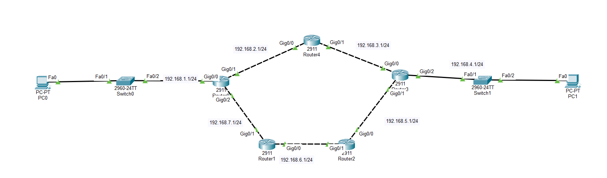
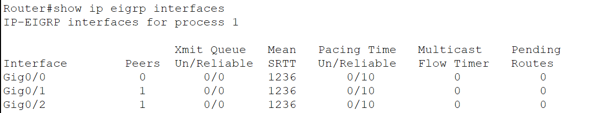
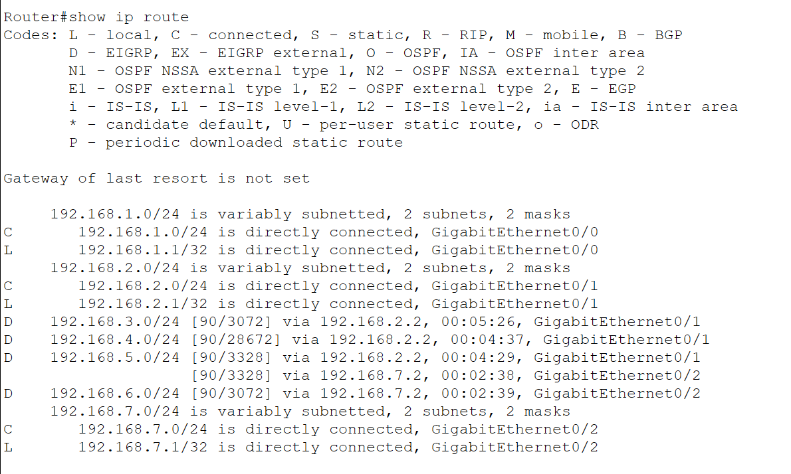
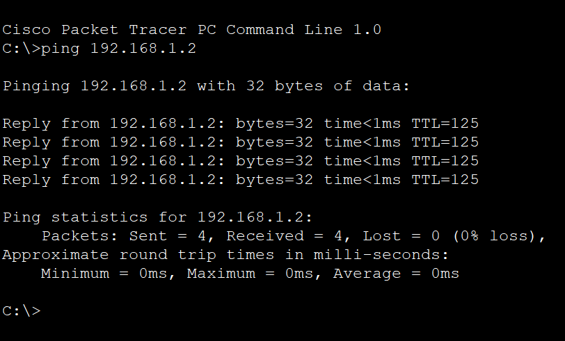

# Multi-Router EIGRP Dual-Path Network & Metric Convergence

A 5-router dual-path redundant backbone engineered in Cisco Packet Tracer, demonstrating EIGRP Autonomous System 1 dynamic convergence, composite metric calculation, successor route selection, Equal-Cost Multi-Path (ECMP) load balancing, and end-to-end data plane transmission.

---

## 🎯 Objective

Design and deploy a 5-router redundant backbone topology interconnecting two local area networks (LAN 1 and LAN 2) across bifurcated transit paths:
1. **Upper Path (2-hop path):** Router0 ➔ Router4 ➔ Router3
2. **Lower Path (3-hop path):** Router0 ➔ Router1 ➔ Router2 ➔ Router3

Configure **EIGRP** (Autonomous System 1) across all nodes, examine EIGRP process interface participation (`show ip eigrp interfaces`), inspect routing table metric behavior and ECMP load balancing (`show ip route`), and validate end-to-end reachability with TTL-based transit analysis (`ping 192.168.1.2`).

---

## 🌐 Network Architecture & Topology

```mermaid
flowchart LR
    subgraph LAN1["🏠 Access LAN 1 (192.168.1.0/24)"]
        direction LR
        PC0["PC0<br/>192.168.1.2/24"] --- SW0["Switch0<br/>2960-24TT"]
    end

    SW0 ---|Fa0/2 - Gig0/0| R0["Router0 (2911)<br/>Gateway: 192.168.1.1"]

    subgraph UpperPath["⬆️ Upper Transit Path (2 Hops)"]
        direction LR
        R4["Router4 (2911)<br/>Gig0/0: .2.2<br/>Gig0/1: .3.1"]
    end

    subgraph LowerPath["⬇️ Lower Transit Path (3 Hops)"]
        direction LR
        R1["Router1 (2911)<br/>Gig0/1: .7.2<br/>Gig0/0: .6.1"] ---|192.168.6.0/24| R2["Router2 (2911)<br/>Gig0/1: .6.2<br/>Gig0/0: .5.1"]
    end

    R0 ---|192.168.2.0/24 (Gig0/1)| R4
    R0 ---|192.168.7.0/24 (Gig0/2)| R1

    R4 ---|192.168.3.0/24 (Gig0/1)| R3["Router3 (2911)<br/>Gateway: 192.168.4.1"]
    R2 ---|192.168.5.0/24 (Gig0/0)| R3

    subgraph LAN2["🏢 Access LAN 2 (192.168.4.0/24)"]
        direction LR
        R3 ---|Gig0/2 - Fa0/1| SW1["Switch1<br/>2960-24TT"] --- PC1["PC1<br/>192.168.4.2/24"]
    end
```

### Visual Evidence: Packet Tracer Topology



---

## 📋 Comprehensive Addressing Scheme

| Subnet Identifier | Subnet CIDR | Interface / Node A | Assigned IP A | Interface / Node B | Assigned IP B | Role / Purpose |
|---|---|---|---|---|---|---|
| **LAN 1** | `192.168.1.0/24` | Router0 `Gig0/0` | `192.168.1.1` | PC0 `Fa0` | `192.168.1.2` | Access Network 1 (Switch0) |
| **Transit Link 1** | `192.168.2.0/24` | Router0 `Gig0/1` | `192.168.2.1` | Router4 `Gig0/0` | `192.168.2.2` | Upper Path (Router0 ➔ Router4) |
| **Transit Link 2** | `192.168.3.0/24` | Router4 `Gig0/1` | `192.168.3.1` | Router3 `Gig0/0` | `192.168.3.2` | Upper Path (Router4 ➔ Router3) |
| **LAN 2** | `192.168.4.0/24` | Router3 `Gig0/2` | `192.168.4.1` | PC1 `Fa0` | `192.168.4.2` | Access Network 2 (Switch1) |
| **Transit Link 3** | `192.168.5.0/24` | Router2 `Gig0/0` | `192.168.5.1` | Router3 `Gig0/1` | `192.168.5.2` | Lower Path (Router2 ➔ Router3) |
| **Transit Link 4** | `192.168.6.0/24` | Router1 `Gig0/0` | `192.168.6.1` | Router2 `Gig0/1` | `192.168.6.2` | Lower Path (Router1 ➔ Router2) |
| **Transit Link 5** | `192.168.7.0/24` | Router0 `Gig0/2` | `192.168.7.1` | Router1 `Gig0/1` | `192.168.7.2` | Lower Path (Router0 ➔ Router1) |

---

## 🖥️ Cisco IOS Configuration Scripts

### Router 0 (Origin Gateway & Fork Node)

```bash
enable
configure terminal
hostname Router0

! 1. LAN 1 Interface
interface GigabitEthernet0/0
 ip address 192.168.1.1 255.255.255.0
 no shutdown
exit

! 2. Upper Transit Interface (towards Router4)
interface GigabitEthernet0/1
 ip address 192.168.2.1 255.255.255.0
 no shutdown
exit

! 3. Lower Transit Interface (towards Router1)
interface GigabitEthernet0/2
 ip address 192.168.7.1 255.255.255.0
 no shutdown
exit

! 4. EIGRP Dynamic Routing Protocol (AS 1)
router eigrp 1
 network 192.168.1.0 0.0.0.255
 network 192.168.2.0 0.0.0.255
 network 192.168.7.0 0.0.0.255
 no auto-summary
exit

end
copy running-config startup-config
```

---

### Router 4 (Upper Path Transit Node)

```bash
enable
configure terminal
hostname Router4

! 1. Interface towards Router0
interface GigabitEthernet0/0
 ip address 192.168.2.2 255.255.255.0
 no shutdown
exit

! 2. Interface towards Router3
interface GigabitEthernet0/1
 ip address 192.168.3.1 255.255.255.0
 no shutdown
exit

! 3. EIGRP AS 1 Configuration
router eigrp 1
 network 192.168.2.0 0.0.0.255
 network 192.168.3.0 0.0.0.255
 no auto-summary
exit

end
copy running-config startup-config
```

---

### Router 1 (Lower Path Intermediate Node 1)

```bash
enable
configure terminal
hostname Router1

! 1. Interface towards Router0
interface GigabitEthernet0/1
 ip address 192.168.7.2 255.255.255.0
 no shutdown
exit

! 2. Interface towards Router2
interface GigabitEthernet0/0
 ip address 192.168.6.1 255.255.255.0
 no shutdown
exit

! 3. EIGRP AS 1 Configuration
router eigrp 1
 network 192.168.7.0 0.0.0.255
 network 192.168.6.0 0.0.0.255
 no auto-summary
exit

end
copy running-config startup-config
```

---

### Router 2 (Lower Path Intermediate Node 2)

```bash
enable
configure terminal
hostname Router2

! 1. Interface towards Router1
interface GigabitEthernet0/1
 ip address 192.168.6.2 255.255.255.0
 no shutdown
exit

! 2. Interface towards Router3
interface GigabitEthernet0/0
 ip address 192.168.5.1 255.255.255.0
 no shutdown
exit

! 3. EIGRP AS 1 Configuration
router eigrp 1
 network 192.168.6.0 0.0.0.255
 network 192.168.5.0 0.0.0.255
 no auto-summary
exit

end
copy running-config startup-config
```

---

### Router 3 (Destination Gateway & Convergence Node)

```bash
enable
configure terminal
hostname Router3

! 1. Upper Path Ingress from Router4
interface GigabitEthernet0/0
 ip address 192.168.3.2 255.255.255.0
 no shutdown
exit

! 2. Lower Path Ingress from Router2
interface GigabitEthernet0/1
 ip address 192.168.5.2 255.255.255.0
 no shutdown
exit

! 3. LAN 2 Access Interface
interface GigabitEthernet0/2
 ip address 192.168.4.1 255.255.255.0
 no shutdown
exit

! 4. EIGRP AS 1 Configuration
router eigrp 1
 network 192.168.3.0 0.0.0.255
 network 192.168.5.0 0.0.0.255
 network 192.168.4.0 0.0.0.255
 no auto-summary
exit

end
copy running-config startup-config
```

---

## 🔍 Protocol Verification & State Diagnostics

### 1. EIGRP Process Interface Participation (`show ip eigrp interfaces`)

```text
Router#show ip eigrp interfaces
IP-EIGRP interfaces for process 1

                     Xmit Queue   Mean   Pacing Time   Multicast    Pending
Interface   Peers    Un/Reliable  SRTT   Un/Reliable   Flow Timer   Routes
Gig0/0        0          0/0      1236       0/10          0           0
Gig0/1        1          0/0      1236       0/10          0           0
Gig0/2        1          0/0      1236       0/10          0           0
```



#### Diagnostic Insights:
- **Process ID:** Verified EIGRP routing process ID `1`.
- **Gig0/0 (LAN 1):** Configured and participating in EIGRP network advertisement with `0` peers (as expected for an access switch/workstation subnet).
- **Gig0/1 (Upper Transit):** Active neighbor adjacency established with `Router4` (`Peers: 1`, `Mean SRTT: 1236ms`).
- **Gig0/2 (Lower Transit):** Active neighbor adjacency established with `Router1` (`Peers: 1`, `Mean SRTT: 1236ms`).
- **Transmit Queues:** Clean transmission queues (`0/0`) indicating instantaneous packet processing and zero packet loss during DUAL update exchanges.

---

### 2. IPv4 Routing Table & Equal-Cost Multi-Path Inspection (`show ip route`)

```text
Router#show ip route
Codes: L - local, C - connected, S - static, R - RIP, M - mobile, B - BGP
       D - EIGRP, EX - EIGRP external, O - OSPF, IA - OSPF inter area
       N1 - OSPF NSSA external type 1, N2 - OSPF NSSA external type 2
       E1 - OSPF external type 1, E2 - OSPF external type 2, E - EGP
       i - IS-IS, L1 - IS-IS level-1, L2 - IS-IS level-2, ia - IS-IS inter area
       * - candidate default, U - per-user static route, o - ODR
       P - periodic downloaded static route

Gateway of last resort is not set

     192.168.1.0/24 is variably subnetted, 2 subnets, 2 masks
C       192.168.1.0/24 is directly connected, GigabitEthernet0/0
L       192.168.1.1/32 is directly connected, GigabitEthernet0/0
     192.168.2.0/24 is variably subnetted, 2 subnets, 2 masks
C       192.168.2.0/24 is directly connected, GigabitEthernet0/1
L       192.168.2.1/32 is directly connected, GigabitEthernet0/1
D    192.168.3.0/24 [90/3072] via 192.168.2.2, 00:05:26, GigabitEthernet0/1
D    192.168.4.0/24 [90/28672] via 192.168.2.2, 00:04:37, GigabitEthernet0/1
D    192.168.5.0/24 [90/3328] via 192.168.2.2, 00:04:29, GigabitEthernet0/1
                    [90/3328] via 192.168.7.2, 00:02:38, GigabitEthernet0/2
D    192.168.6.0/24 [90/3072] via 192.168.7.2, 00:02:39, GigabitEthernet0/2
     192.168.7.0/24 is variably subnetted, 2 subnets, 2 masks
C       192.168.7.0/24 is directly connected, GigabitEthernet0/2
L       192.168.7.1/32 is directly connected, GigabitEthernet0/2
```



#### Architectural Analysis:
1. **Administrative Distance:** All learned routes are tagged with code `D` (EIGRP internal) with Cisco default Administrative Distance of `90`.
2. **Successor Path to Destination LAN 2 (`192.168.4.0/24`):**
   - Chosen via `192.168.2.2` over `GigabitEthernet0/1` with composite metric `[90/28672]`.
   - The DUAL engine selected the upper 2-hop transit path (`Router0 ➔ Router4 ➔ Router3`) as the optimal Feasible Successor / Successor route due to significantly lower cumulative link delay.
3. **Equal-Cost Multi-Path (ECMP) Load Balancing (`192.168.5.0/24`):**
   - The segment connecting `Router2` and `Router3` (`192.168.5.0/24`) achieved identical cumulative composite metrics (`3328`) from both the upper path via `192.168.2.2` (`Gig0/1`) and the lower path via `192.168.7.2` (`Gig0/2`).
   - EIGRP installed both next-hop gateways into the routing table, enabling hardware packet load-balancing across both paths.
4. **Intermediate Segment Routing:**
   - Subnet `192.168.3.0/24` reached via upper next-hop `192.168.2.2` (`[90/3072]`).
   - Subnet `192.168.6.0/24` reached via lower next-hop `192.168.7.2` (`[90/3072]`).

---

### 3. End-to-End Data Plane Verification (`ping 192.168.1.2`)

```text
Cisco Packet Tracer PC Command Line 1.0
C:\>ping 192.168.1.2

Pinging 192.168.1.2 with 32 bytes of data:

Reply from 192.168.1.2: bytes=32 time<1ms TTL=125
Reply from 192.168.1.2: bytes=32 time<1ms TTL=125
Reply from 192.168.1.2: bytes=32 time<1ms TTL=125
Reply from 192.168.1.2: bytes=32 time<1ms TTL=125

Ping statistics for 192.168.1.2:
    Packets: Sent = 4, Received = 4, Lost = 0 (0% loss),
Approximate round trip times in milli-seconds:
    Minimum = 0ms, Maximum = 0ms, Average = 0ms

C:\>
```



#### Packet Flow & TTL Decrement Analysis:
- **Source:** PC1 (`192.168.4.2`) on LAN 2.
- **Destination:** PC0 (`192.168.1.2`) on LAN 1.
- **Initial IP Time-To-Live (TTL):** Standard Windows IP stack generates ICMP packets with initial TTL = `128`.
- **Router Hops Traversed:**
  1. Ingress at `Router3` (Hop 1: TTL decrements from `128` ➔ `127`)
  2. Transit via `Router4` (Hop 2: TTL decrements from `127` ➔ `126`)
  3. Egress at `Router0` (Hop 3: TTL decrements from `126` ➔ `125`)
  4. Delivery to destination `PC0` at `TTL=125`.
- **Result:** Confirms end-to-end routing convergence and deterministic forwarding along the primary EIGRP successor path with 100% success rate (`0% loss`) and sub-millisecond latency (`time<1ms`).

---

## 📊 Verification Matrix

| Test Case | Command / Action | Expected Result | Actual Outcome | Status |
|---|---|---|---|:---:|
| Interface State | `show ip eigrp interfaces` | Process 1 active on Gig0/0, Gig0/1, Gig0/2 | Active; Peers: 0, 1, 1 | **PASSED** |
| Successor Route to LAN 2 | `show ip route 192.168.4.0` | Next-hop via 192.168.2.2 (Upper Path) | Installed [90/28672] via 192.168.2.2 | **PASSED** |
| ECMP Convergence | `show ip route 192.168.5.0` | Dual equal-cost paths via .2.2 and .7.2 | Both next-hops installed with metric 3328 | **PASSED** |
| Data Plane Reachability | `ping 192.168.1.2` | 4/4 Echo replies with TTL=125 | 4 packets received, 0% loss, TTL=125 | **PASSED** |

---

_Documented by **[Jaser Halabi](https://github.com/JaserHalabi)**_
