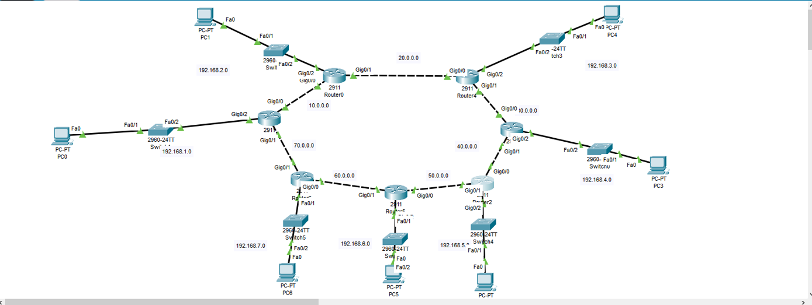
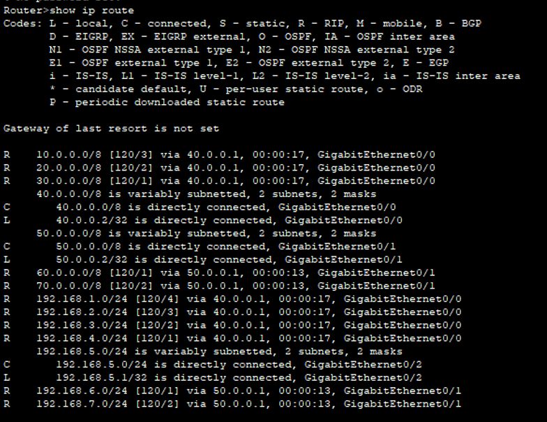
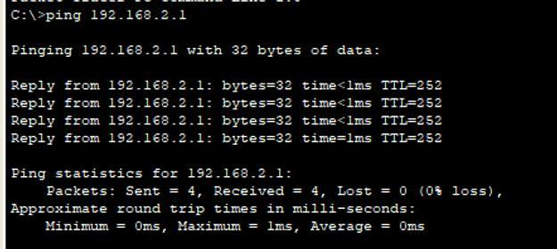

# Enterprise Multi-Router Dynamic RIP Network

A multi-router circular backbone network engineered in Cisco Packet Tracer, demonstrating dynamic distance-vector route distribution, multi-hop convergence, and deterministic hop-count metric path selection using Routing Information Protocol (RIP).

---

## Objective

Design and deploy an 8-router enterprise backbone topology interconnecting 7 distinct local area networks (LANs). Configure the dynamic RIP routing daemon across all routers to establish full mesh reachability, verify split-horizon loop avoidance and hop-count metric accumulation, and validate end-to-end data plane packet transmission across multi-hop paths.

---

## Network Architecture & Addressing Scheme

The topology consists of 14 separate IPv4 subnets: 7 point-to-point GigabitEthernet router-to-router interconnects and 7 access-layer user LANs.

### Inter-Router Backbone Links

| Link | Segment | Interface A | IP A | Interface B | IP B |
|---|---|---|---|---|---|
| Link 1 | `10.0.0.0/8` | Router 1 (Gig0/0) | `10.0.0.1/8` | Router 0 (Gig0/0) | `10.0.0.2/8` |
| Link 2 | `20.0.0.0/8` | Router 0 (Gig0/1) | `20.0.0.1/8` | Router 4 (Gig0/0) | `20.0.0.2/8` |
| Link 3 | `30.0.0.0/8` | Router 4 (Gig0/1) | `30.0.0.1/8` | Router 3 (Gig0/0) | `30.0.0.2/8` |
| Link 4 | `40.0.0.0/8` | Router 3 (Gig0/1) | `40.0.0.1/8` | Router 2 (Gig0/0) | `40.0.0.2/8` |
| Link 5 | `50.0.0.0/8` | Router 2 (Gig0/1) | `50.0.0.2/8` | Router 5 (Gig0/0) | `50.0.0.1/8` |
| Link 6 | `60.0.0.0/8` | Router 5 (Gig0/1) | `60.0.0.1/8` | Router 6 (Gig0/0) | `60.0.0.2/8` |
| Link 7 | `70.0.0.0/8` | Router 6 (Gig0/1) | `70.0.0.1/8` | Router 1 (Gig0/1) | `70.0.0.2/8` |

### Access-Layer User Subnets

| Subnet | Gateway Router | Gateway Interface | Default Gateway | Host Range | Switch Model | End Device |
|---|---|---|---|---|---|---|
| `192.168.1.0/24` | Router 1 | `GigabitEthernet0/2` | `192.168.1.1` | `192.168.1.2 - .254` | Catalyst 2960 | PC0 |
| `192.168.2.0/24` | Router 0 | `GigabitEthernet0/2` | `192.168.2.1` | `192.168.2.2 - .254` | Catalyst 2960 | PC1 |
| `192.168.3.0/24` | Router 4 | `GigabitEthernet0/2` | `192.168.3.1` | `192.168.3.2 - .254` | Catalyst 2960 | PC4 |
| `192.168.4.0/24` | Router 3 | `GigabitEthernet0/2` | `192.168.4.1` | `192.168.4.2 - .254` | Catalyst 2960 | PC3 |
| `192.168.5.0/24` | Router 2 | `GigabitEthernet0/2` | `192.168.5.1` | `192.168.5.2 - .254` | Catalyst 2960 | PC2 |
| `192.168.6.0/24` | Router 5 | `GigabitEthernet0/2` | `192.168.6.1` | `192.168.6.2 - .254` | Catalyst 2960 | PC5 |
| `192.168.7.0/24` | Router 6 | `GigabitEthernet0/2` | `192.168.7.1` | `192.168.7.2 - .254` | Catalyst 2960 | PC6 |

---

## Topology Architecture

The network connects Cisco 2911 Integrated Services Routers in a closed loop structure. Each node services a local switch-and-workstation access segment while providing redundant transit paths across the backbone:



---

## Cisco IOS Configuration

### Router 2 Configuration (Central Node)

```bash
enable
configure terminal

! 1. Inter-Router Interface towards Router 3 (Clockwise Path)
interface GigabitEthernet0/0
 ip address 40.0.0.2 255.0.0.0
 no shutdown
exit

! 2. Inter-Router Interface towards Router 5 (Counter-Clockwise Path)
interface GigabitEthernet0/1
 ip address 50.0.0.2 255.0.0.0
 no shutdown
exit

! 3. Local Access Subnet Gateway
interface GigabitEthernet0/2
 ip address 192.168.5.1 255.255.255.0
 no shutdown
exit

! 4. Dynamic RIP Routing Configuration
router rip
 version 2
 no auto-summary
 network 40.0.0.0
 network 50.0.0.0
 network 192.168.5.0
exit

end
copy running-config startup-config
```

### Representative Neighbor Router Configuration (Router 0)

```bash
enable
configure terminal

interface GigabitEthernet0/0
 ip address 10.0.0.2 255.0.0.0
 no shutdown
exit

interface GigabitEthernet0/1
 ip address 20.0.0.1 255.0.0.0
 no shutdown
exit

interface GigabitEthernet0/2
 ip address 192.168.2.1 255.255.255.0
 no shutdown
exit

router rip
 version 2
 no auto-summary
 network 10.0.0.0
 network 20.0.0.0
 network 192.168.2.0
exit

end
copy running-config startup-config
```

---

## Routing Table Analysis & Verification

### Routing Table State (`show ip route`)

Captured on **Router 2**, inspecting dynamic routing updates across the circular topology:



```text
Router>show ip route
Codes: L - local, C - connected, S - static, R - RIP, M - mobile, B - BGP
       D - EIGRP, EX - EIGRP external, O - OSPF, IA - OSPF inter area
       N1 - OSPF NSSA external type 1, N2 - OSPF NSSA external type 2
       E1 - OSPF external type 1, E2 - OSPF external type 2, E - EGP
       i - IS-IS, L1 - IS-IS level-1, L2 - IS-IS level-2, ia - IS-IS inter area
       * - candidate default, U - per-user static route, o - ODR
       P - periodic downloaded static route

Gateway of last resort is not set

R     10.0.0.0/8 [120/3] via 40.0.0.1, 00:00:17, GigabitEthernet0/0
R     20.0.0.0/8 [120/2] via 40.0.0.1, 00:00:17, GigabitEthernet0/0
R     30.0.0.0/8 [120/1] via 40.0.0.1, 00:00:17, GigabitEthernet0/0
      40.0.0.0/8 is variably subnetted, 2 subnets, 2 masks
C        40.0.0.0/8 is directly connected, GigabitEthernet0/0
L        40.0.0.2/32 is directly connected, GigabitEthernet0/0
      50.0.0.0/8 is variably subnetted, 2 subnets, 2 masks
C        50.0.0.0/8 is directly connected, GigabitEthernet0/1
L        50.0.0.2/32 is directly connected, GigabitEthernet0/1
R     60.0.0.0/8 [120/1] via 50.0.0.1, 00:00:13, GigabitEthernet0/1
R     70.0.0.0/8 [120/2] via 50.0.0.1, 00:00:13, GigabitEthernet0/1
R     192.168.1.0/24 [120/4] via 40.0.0.1, 00:00:17, GigabitEthernet0/0
R     192.168.2.0/24 [120/3] via 40.0.0.1, 00:00:17, GigabitEthernet0/0
R     192.168.3.0/24 [120/2] via 40.0.0.1, 00:00:17, GigabitEthernet0/0
R     192.168.4.0/24 [120/1] via 40.0.0.1, 00:00:17, GigabitEthernet0/0
      192.168.5.0/24 is variably subnetted, 2 subnets, 2 masks
C        192.168.5.0/24 is directly connected, GigabitEthernet0/2
L        192.168.5.1/32 is directly connected, GigabitEthernet0/2
R     192.168.6.0/24 [120/1] via 50.0.0.1, 00:00:13, GigabitEthernet0/1
R     192.168.7.0/24 [120/2] via 50.0.0.1, 00:00:13, GigabitEthernet0/1
```

### Key Protocol Observations

1. **Deterministic Path Selection:** RIP selects paths strictly based on minimum hop count.
   - Remote subnet `192.168.1.0/24` is reached via next-hop `40.0.0.1` with metric `[120/4]` (4 hops).
   - Remote subnet `192.168.7.0/24` is reached via next-hop `50.0.0.1` with metric `[120/2]` (2 hops).
2. **Administrative Distance & Metric Format:** Every RIP route is marked with administrative distance `120` followed by the accumulated hop count metric `[120/<hops>]`.
3. **Bifurcated Routing Traffic:** Traffic to subnets 1 through 4 exits `GigabitEthernet0/0`, while traffic to subnets 6 and 7 exits `GigabitEthernet0/1`, balancing load across both sides of the backbone ring.

---

## End-to-End Connectivity Verification

### Cross-Network ICMP Ping Diagnostics

Executing a cross-backbone ping test from a client workstation targeting gateway `192.168.2.1`:



```text
C:\>ping 192.168.2.1

Pinging 192.168.2.1 with 32 bytes of data:

Reply from 192.168.2.1: bytes=32 time<1ms TTL=252
Reply from 192.168.2.1: bytes=32 time<1ms TTL=252
Reply from 192.168.2.1: bytes=32 time<1ms TTL=252
Reply from 192.168.2.1: bytes=32 time<1ms TTL=252

Ping statistics for 192.168.2.1:
    Packets: Sent = 4, Received = 4, Lost = 0 (0% loss),
Approximate round trip times in milli-seconds:
    Minimum = 0ms, Maximum = 1ms, Average = 0ms
```

### Time-to-Live (TTL) Validation

- The base IP packet TTL generated by Cisco IOS is `255`.
- The received packet demonstrates `TTL=252`, verifying that exactly $255 - 252 = 3$ routing hops were traversed along the path.
- This empirically confirms the routing table metric entry `[120/3]` for network `192.168.2.0/24`.

---

_Back to [Master Portfolio](../README.md)_
