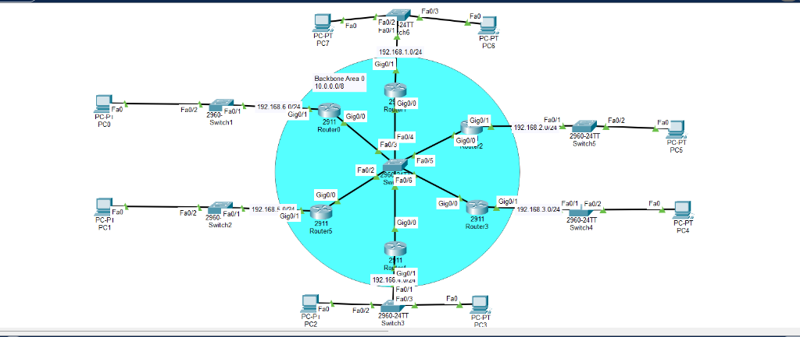
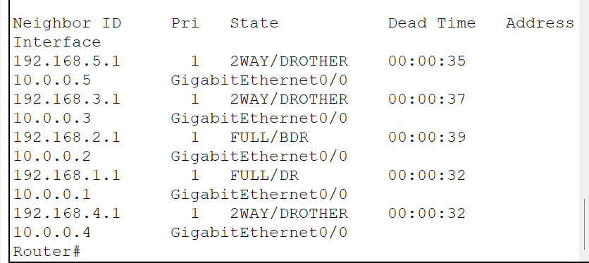
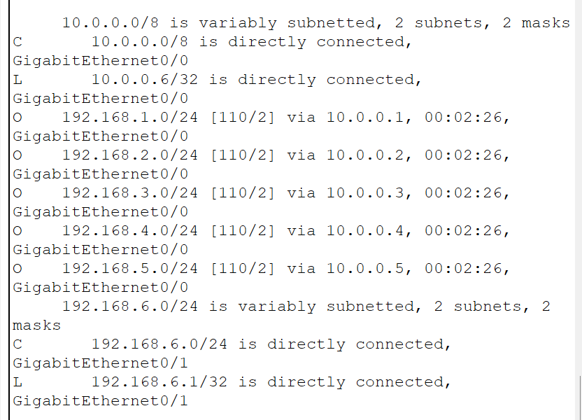
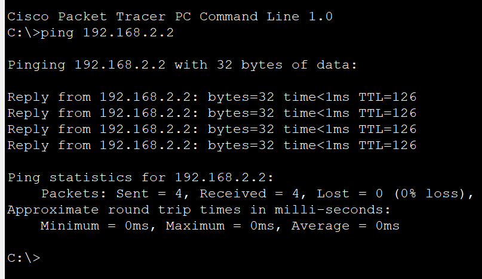

# OSPF Multi-Access Network & DR/BDR Election

A broadcast multi-access OSPF (Area 0) topology configured in Cisco Packet Tracer, demonstrating dynamic Designated Router (DR) and Backup Designated Router (BDR) election, adjacency states, and full multi-LAN reachability.

---

## Objective

Connect 6 Cisco 2911 routers to a central Layer 2 switch over a shared broadcast multi-access transit network (`10.0.0.0/8`). Configure single-area OSPF (Area 0), observe DR/BDR/DROTHER election behavior, and verify end-to-end routing between 6 access LANs.

---

## Topology

The network features a central multi-access backbone switch interconnecting 6 routers, each hosting an access-layer user LAN:



### Addressing Table

| Device | Interface | IP Address | Subnet Mask | Role / Connection |
|---|---|---|---|---|
| **Central Switch** | `Fa0/1 - Fa0/6` | — | — | Shared Backbone Area 0 (`10.0.0.0/8`) |
| **Router0** | `Gig0/0` | `10.0.0.6` | `255.0.0.0` | Backbone Area 0 (DROTHER) |
| | `Gig0/1` | `192.168.6.1` | `255.255.255.0` | LAN 6 Gateway (`192.168.6.0/24`) |
| **Router1** | `Gig0/0` | `10.0.0.1` | `255.0.0.0` | Backbone Area 0 (Elected DR) |
| | `Gig0/1` | `192.168.1.1` | `255.255.255.0` | LAN 1 Gateway (`192.168.1.0/24`) |
| **Router2** | `Gig0/0` | `10.0.0.2` | `255.0.0.0` | Backbone Area 0 (Elected BDR) |
| | `Gig0/1` | `192.168.2.1` | `255.255.255.0` | LAN 2 Gateway (`192.168.2.0/24`) |
| **Router3** | `Gig0/0` | `10.0.0.3` | `255.0.0.0` | Backbone Area 0 (DROTHER) |
| | `Gig0/1` | `192.168.3.1` | `255.255.255.0` | LAN 3 Gateway (`192.168.3.0/24`) |
| **Router4** | `Gig0/0` | `10.0.0.4` | `255.0.0.0` | Backbone Area 0 (DROTHER) |
| | `Gig0/1` | `192.168.4.1` | `255.255.255.0` | LAN 4 Gateway (`192.168.4.0/24`) |
| **Router5** | `Gig0/0` | `10.0.0.5` | `255.0.0.0` | Backbone Area 0 (DROTHER) |
| | `Gig0/1` | `192.168.5.1` | `255.255.255.0` | LAN 5 Gateway (`192.168.5.0/24`) |

---

## Cisco IOS Configuration

### Router0 Configuration (Representative Node)

```bash
enable
configure terminal

! 1. Configure Backbone Multi-Access Interface
interface GigabitEthernet0/0
 ip address 10.0.0.6 255.0.0.0
 no shutdown
exit

! 2. Configure Local Access LAN Interface
interface GigabitEthernet0/1
 ip address 192.168.6.1 255.255.255.0
 no shutdown
exit

! 3. Configure OSPF Process in Area 0
router ospf 1
 router-id 192.168.6.1
 network 10.0.0.0 0.255.255.255 area 0
 network 192.168.6.0 0.0.0.255 area 0
exit

end
copy running-config startup-config
```

---

## Verification

### 1. OSPF Neighbor Table & DR/BDR States

Inspect neighbor adjacencies from **Router0** across the shared multi-access network:



```text
Neighbor ID     Pri   State            Dead Time   Address      Interface
192.168.5.1       1   2WAY/DROTHER     00:00:35    10.0.0.5     GigabitEthernet0/0
192.168.3.1       1   2WAY/DROTHER     00:00:37    10.0.0.3     GigabitEthernet0/0
192.168.2.1       1   FULL/BDR         00:00:39    10.0.0.2     GigabitEthernet0/0
192.168.1.1       1   FULL/DR          00:00:32    10.0.0.1     GigabitEthernet0/0
192.168.4.1       1   2WAY/DROTHER     00:00:32    10.0.0.4     GigabitEthernet0/0
```

- **Designated Router (DR):** Router 1 (`192.168.1.1`) reaches `FULL/DR` state.
- **Backup Designated Router (BDR):** Router 2 (`192.168.2.1`) reaches `FULL/BDR` state.
- **DROTHER Neighbors:** Routers 3, 4, and 5 remain in `2WAY/DROTHER` state. This confirms standard OSPF multi-access optimization, preventing full mesh adjacency overhead while maintaining full routing visibility.

### 2. Routing Table State (`show ip route`)

Captured on **Router0**, verifying that all 5 remote user LANs are dynamically installed via OSPF (`O`):



```text
     10.0.0.0/8 is variably subnetted, 2 subnets, 2 masks
C       10.0.0.0/8 is directly connected, GigabitEthernet0/0
L       10.0.0.6/32 is directly connected, GigabitEthernet0/0
O    192.168.1.0/24 [110/2] via 10.0.0.1, 00:02:26, GigabitEthernet0/0
O    192.168.2.0/24 [110/2] via 10.0.0.2, 00:02:26, GigabitEthernet0/0
O    192.168.3.0/24 [110/2] via 10.0.0.3, 00:02:26, GigabitEthernet0/0
O    192.168.4.0/24 [110/2] via 10.0.0.4, 00:02:26, GigabitEthernet0/0
O    192.168.5.0/24 [110/2] via 10.0.0.5, 00:02:26, GigabitEthernet0/0
     192.168.6.0/24 is variably subnetted, 2 subnets, 2 masks
C       192.168.6.0/24 is directly connected, GigabitEthernet0/1
L       192.168.6.1/32 is directly connected, GigabitEthernet0/1
```

- Every remote network is learned directly with cost `[110/2]`, routed directly to each neighbor's `10.0.0.x` interface across the backbone switch.

### 3. End-to-End Connectivity (Ping Test)

Verifying cross-network reachability by pinging client `192.168.2.2` (on LAN 2) from PC0 (on LAN 6):



```text
Cisco Packet Tracer PC Command Line 1.0
C:\>ping 192.168.2.2

Pinging 192.168.2.2 with 32 bytes of data:

Reply from 192.168.2.2: bytes=32 time<1ms TTL=126
Reply from 192.168.2.2: bytes=32 time<1ms TTL=126
Reply from 192.168.2.2: bytes=32 time<1ms TTL=126
Reply from 192.168.2.2: bytes=32 time<1ms TTL=126

Ping statistics for 192.168.2.2:
    Packets: Sent = 4, Received = 4, Lost = 0 (0% loss),
Approximate round trip times in milli-seconds:
    Minimum = 0ms, Maximum = 1ms, Average = 0ms
```

- **Packet Loss:** 0% loss across all ICMP echo requests.
- **Hop Count Validation:** `TTL=126` confirms exactly 2 router hops traversed ($128 - 2 = 126$), matching the multi-access backbone path.

---

_Back to [Master Portfolio](../README.md)_
