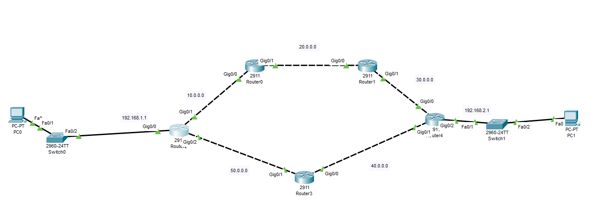
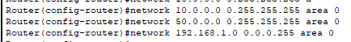
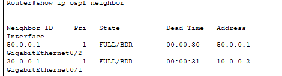
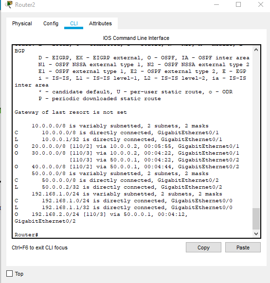
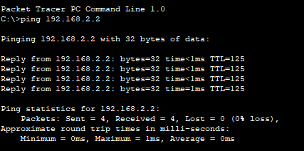

# OSPF Single-Area Routing

Implementation of single-area Open Shortest Path First (OSPFv2) in Cisco Packet Tracer, demonstrating link-state routing, dynamic neighbor adjacency, equal-cost multi-path (ECMP) load balancing, and end-to-end connectivity.

---

## Objective

Configure single-area OSPF (Area 0) across a multi-router topology to dynamically exchange routing information between isolated LAN subnets (`192.168.1.0/24` and `192.168.2.0/24`), verify neighbor states, and test path convergence.

---

## Topology

The topology features two access networks interconnected by a redundant multi-router transit backbone:



### Addressing Table

| Device | Interface | IP Address | Subnet Mask | Connected To |
|---|---|---|---|---|
| **Router2** | `GigabitEthernet0/0` | `192.168.1.1` | `255.255.255.0` | LAN 1 Gateway (Switch0) |
| | `GigabitEthernet0/1` | `10.0.0.1` | `255.0.0.0` | Router0 (`Gig0/0`) |
| | `GigabitEthernet0/2` | `50.0.0.2` | `255.0.0.0` | Router3 (`Gig0/1`) |
| **Router0** | `GigabitEthernet0/0` | `10.0.0.2` | `255.0.0.0` | Router2 (`Gig0/1`) |
| | `GigabitEthernet0/1` | `20.0.0.1` | `255.0.0.0` | Router1 (`Gig0/0`) |
| **Router1** | `GigabitEthernet0/0` | `20.0.0.2` | `255.0.0.0` | Router0 (`Gig0/1`) |
| | `GigabitEthernet0/1` | `30.0.0.1` | `255.0.0.0` | Router4 (`Gig0/0`) |
| **Router3** | `GigabitEthernet0/1` | `50.0.0.1` | `255.0.0.0` | Router2 (`Gig0/2`) |
| | `GigabitEthernet0/0` | `40.0.0.1` | `255.0.0.0` | Router4 (`Gig0/1`) |
| **Router4** | `GigabitEthernet0/0` | `30.0.0.2` | `255.0.0.0` | Router1 (`Gig0/1`) |
| | `GigabitEthernet0/1` | `40.0.0.2` | `255.0.0.0` | Router3 (`Gig0/0`) |
| | `GigabitEthernet0/2` | `192.168.2.1` | `255.255.255.0` | LAN 2 Gateway (Switch1) |
| **PC0** | `FastEthernet0` | `192.168.1.2` | `255.255.255.0` | Gateway: `192.168.1.1` |
| **PC1** | `FastEthernet0` | `192.168.2.2` | `255.255.255.0` | Gateway: `192.168.2.1` |

---

## Cisco IOS Configuration

### Router2 Configuration

```bash
enable
configure terminal

! 1. Configure Interfaces
interface GigabitEthernet0/0
 ip address 192.168.1.1 255.255.255.0
 no shutdown
exit

interface GigabitEthernet0/1
 ip address 10.0.0.1 255.0.0.0
 no shutdown
exit

interface GigabitEthernet0/2
 ip address 50.0.0.2 255.0.0.0
 no shutdown
exit

! 2. Configure OSPF Area 0
router ospf 1
 network 10.0.0.0 0.255.255.255 area 0
 network 50.0.0.0 0.255.255.255 area 0
 network 192.168.1.0 0.0.0.255 area 0
exit

end
copy running-config startup-config
```



---

## Verification

### 1. OSPF Neighbor Adjacency

Verify that OSPF neighbor relationships have established in the `FULL` state across transit interfaces:



```text
Router#show ip ospf neighbor

Neighbor ID     Pri   State           Dead Time   Address         Interface
50.0.0.1          1   FULL/BDR        00:00:30    50.0.0.1        GigabitEthernet0/2
20.0.0.1          1   FULL/BDR        00:00:31    10.0.0.2        GigabitEthernet0/1
```

### 2. Routing Table Inspection

Verify routes learned through OSPF (marked with code `O` and Administrative Distance `110`):



```text
Router#show ip route
...
Gateway of last resort is not set

     10.0.0.0/8 is variably subnetted, 2 subnets, 2 masks
C       10.0.0.0/8 is directly connected, GigabitEthernet0/1
L       10.0.0.1/32 is directly connected, GigabitEthernet0/1
O    20.0.0.0/8 [110/2] via 10.0.0.2, 00:05:55, GigabitEthernet0/1
O    30.0.0.0/8 [110/3] via 10.0.0.2, 00:04:22, GigabitEthernet0/1
                [110/3] via 50.0.0.1, 00:04:22, GigabitEthernet0/2
O    40.0.0.0/8 [110/2] via 50.0.0.1, 00:04:44, GigabitEthernet0/2
     50.0.0.0/8 is variably subnetted, 2 subnets, 2 masks
C       50.0.0.0/8 is directly connected, GigabitEthernet0/2
L       50.0.0.2/32 is directly connected, GigabitEthernet0/2
     192.168.1.0/24 is variably subnetted, 2 subnets, 2 masks
C       192.168.1.0/24 is directly connected, GigabitEthernet0/0
L       192.168.1.1/32 is directly connected, GigabitEthernet0/0
O    192.168.2.0/24 [110/3] via 50.0.0.1, 00:04:12, GigabitEthernet0/2
```

> **Note on ECMP:** Subnet `30.0.0.0/8` has equal cost (`[110/3]`) through both next-hops (`10.0.0.2` and `50.0.0.1`), demonstrating automatic Equal-Cost Multi-Path load balancing.

### 3. End-to-End Connectivity (Ping Test)

Ping from `PC0` (`192.168.1.2`) across the OSPF backbone to `PC1` (`192.168.2.2`):



```text
C:\>ping 192.168.2.2

Pinging 192.168.2.2 with 32 bytes of data:

Reply from 192.168.2.2: bytes=32 time<1ms TTL=125
Reply from 192.168.2.2: bytes=32 time<1ms TTL=125
Reply from 192.168.2.2: bytes=32 time<1ms TTL=125
Reply from 192.168.2.2: bytes=32 time=1ms TTL=125

Ping statistics for 192.168.2.2:
    Packets: Sent = 4, Received = 4, Lost = 0 (0% loss),
Approximate round trip times in milli-seconds:
    Minimum = 0ms, Maximum = 1ms, Average = 0ms
```

- **Packet Loss:** 0% loss across all 4 ICMP packets.
- **TTL Validation:** Received `TTL=125` (standard initial TTL 128 minus 3 router hops).

---

_Back to [Master Portfolio](../README.md)_
